# Retail Cashier Efficiency Engine (Part 1) and Shift Planner (Part 2)

[](https://github.com/farhamfakouri-hub/Fairlane/actions/workflows/ci.yml)

Fair, explainable efficiency scores for supermarket cashiers, computed from register event logs and graded on a simulated store whose true cashier skills are hidden from the engine and revealed only to the experiments that test it.

Part 1 produces scores, uncertainty intervals and reasons. Part 2, the shift planner and daily coordinator, reads them through the interface in `src/ree/api/provider.py` and is described in [its own section](#part-2-shift-planner-and-daily-coordinator) below, with its own limits.

Everything below is measured on simulated data with assumed parameters. Read [What this does not prove](#what-this-does-not-prove) before quoting any number.

## The problem

A store manager wants to know who is fast and who is accurate at the till, to plan rush-hour shifts. The obvious measures are unfair:

- **Items per hour** punishes whoever is given big baskets, slow lanes and rush hours, and rewards whoever is given small baskets and quiet lanes. When the simulated store assigns strong cashiers the easy work, this measure ranks cashiers almost at random: Spearman correlation 0.05 with their true speed.
- **Ignoring every gap above 5 seconds** between scans deletes real work from slow cashiers. It never exceeds 0.59 here.

What is needed is a score that separates the cashier from the situation, says how sure it is, can be explained to the cashier, and does not let one bad week define a person.

## The idea in plain words

1. **Cut out waiting, not work.** A pause rule (idle after 15 s, stop after 60 s) separates customer delays and interruptions from scanning. A transaction with a long interruption does not count for speed, but it still counts for accuracy.
2. **Compare like with like.** Each transaction is compared with the time a typical cashier needs for the same basket on the same lane type in the same period (peak or off-peak). Version 1 uses medians in basket-size bins. Version 2 fits a price list by regression (seconds per scanned item, per hand-keyed item, per tag removed, per voucher, loyalty card, and a fixed cost per transaction) and compares log ratios. Version 2 is the default.
3. **Do not trust thin data.** A cashier with few transactions is pulled toward the store average by the weight n / (n + 150). The score is `50 + 15 z`, where every z-score is capped at plus or minus 3.
4. **Accuracy from two signals**: the void rate and the weekly cash discrepancy of the drawer. Shared drawers are split by cash share, drawers with an unclear owner are dropped, older weeks count less (half-life 4 weeks).
5. **Say how sure you are.** Speed intervals come from a bootstrap that resamples whole sessions, accuracy intervals from one that resamples weeks. Tier A (top 20 percent) or C (bottom 20 percent) is shown only when the whole interval clears the cutoff. Every score lists its main reasons, new cashiers are labelled provisional, and a cashier can contest a score.

The method the engine follows is in `docs/method_scoring.md`; every default and every departure from it is listed in `docs/decisions.md`.

## Architecture

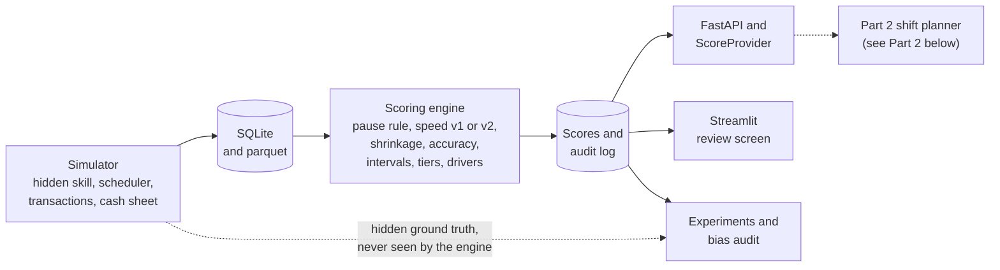

Inside the engine, each score goes through the same steps:

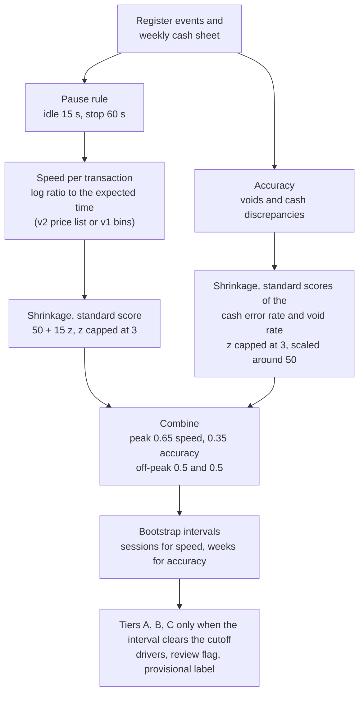

The engine reads `StoreData` only. The hidden ground truth lives in a separate table that the engine's database connection is forbidden to read (a test checks this), and a test checks that no table or output has a field named like a customer, an item or an absence.

## Quickstart

Python 3.11 or newer. With [uv](https://docs.astral.sh/uv/getting-started/installation/) (recommended; the committed `uv.lock` pins the versions the project was tested with):

```bash
git clone https://github.com/farhamfakouri-hub/Fairlane.git
cd Fairlane
uv sync --all-groups
uv run python -m ree.cli smoke
uv run pytest
```

`uv sync --all-groups` installs the package, its dependencies and the `dev` group (pytest, hypothesis, ruff and httpx2, the HTTP client behind the API tests). `uv sync` on its own installs the `dev` group too, because uv includes it by default.

With pip, on Windows (PowerShell):

```powershell
python -m venv .venv
.venv\Scripts\python.exe -m pip install -e ".[dev]"
.venv\Scripts\python.exe -m ree.cli smoke
.venv\Scripts\python.exe -m pytest
```

With pip, on macOS or Linux:

```bash
python3 -m venv .venv
.venv/bin/python -m pip install -e ".[dev]"
.venv/bin/python -m ree.cli smoke
.venv/bin/python -m pytest
```

With GNU make (it wraps the pip route): `make setup && make smoke && make test`.

`smoke` simulates a small store, scores it twice and checks the reruns are byte-identical, probes the API in process, runs a reduced experiment and loads every screen, then prints a PASS or FAIL line for each step (about 20 seconds on an idle development machine). It needs no test libraries: only `pytest` and the API tests use httpx2.

Everything else is one command (put `uv run` in front, or replace `python` by the path of your virtual environment's interpreter):

| command | what it does |
| --- | --- |
| `python -m ree.cli simulate` | writes a 25-cashier, 12-week store to `data/default` (SQLite and parquet) |
| `python -m ree.cli score` | scores it, writes `scores.json` and one audit row |
| `python -m ree.cli api` | serves the scores at http://127.0.0.1:8000 (interactive docs at `/docs`) |
| `python -m ree.cli ui` | review screen at http://127.0.0.1:8501 |
| `python -m ree.cli experiments` | regenerates every figure and `outputs/reports/results.md` (about 10 minutes with 4 processes; `--reduced` for a quick check) |
| `python -m ree.cli export-openapi` | rewrites `docs/openapi.json` |

Settings live in `config/default.yaml`, which is generated from the code defaults (a test keeps them identical). Pass another file with `--config`. The API and the review screen are demonstration services without authentication; both bind to 127.0.0.1 unless you pass `--host`.

## What a score looks like

One record from the smoke store (`python -m ree.cli smoke` leaves it in `data/smoke/scores.json`; values are rounded, fields are regrouped and trimmed, and the version string is shortened here):

```json
{
  "worker_id": "W001",
  "score_peak": 56.38, "interval_peak": {"lower": 55.19, "upper": 56.84}, "tier_peak": "B",
  "score_off": 56.49,  "interval_off":  {"lower": 54.75, "upper": 57.17}, "tier_off": "B",
  "provisional": false,
  "weeks_of_data": 4,
  "n_transactions": 2131,
  "drivers": ["cash discrepancies below the store norm"],
  "review_flag": null,
  "components": {"speed_score_peak": 55.04, "speed_score_off": 54.09, "accuracy_score": 58.88, "...": "..."},
  "model_version": "ree-0.1.0-…",
  "computed_at": "2025-12-21T12:30:16"
}
```

The API (`docs/openapi.json`) serves `GET /scores`, `GET /scores/{worker_id}`, `GET /scores/ranking?context=peak&min_confidence=0.5`, `POST /appeals`, `GET /appeals` and `GET /health`. Workers whose confidence is below `min_confidence` stay in the ranking at the cohort average, flagged as unrated. The review screen has a manager table (sortable, filterable), a worker view that explains the score in plain language and takes an appeal, a method explainer with the formulas and a live transaction, and a sidebar that regenerates and re-scores a store.

## Results

Every number in this section is copied from `outputs/reports/results.md`, which `python -m ree.cli experiments` (source `src/ree/experiments/run_all.py`) regenerates from a seed. Six scenarios, 10 stores per scenario (25 cashiers, 12 weeks unless the scenario says otherwise), the same stores for every method. Spearman correlation between each method's score and the cashier's hidden true speed, averaged over off-peak and peak (table "Spearman correlation with true speed"; the report also gives 95 percent intervals, Kendall tau, top-5 precision and rank error):

| method | balanced | biased assignment | 2 weeks of data | heavy interruptions | newcomers | shared tills |
| --- | --- | --- | --- | --- | --- | --- |
| naive items per shift | 0.836 | 0.051 | 0.521 | 0.825 | 0.732 | 0.836 |
| hard 5 s stop | 0.587 | 0.507 | 0.545 | 0.577 | 0.324 | 0.587 |
| v1 bins, no pause rule | 0.996 | 0.987 | 0.977 | 0.995 | 0.935 | 0.996 |
| v1 bins + pause rule | 0.996 | 0.988 | 0.976 | 0.995 | 0.934 | 0.996 |
| **v2 regression (OLS) + pause rule** (default) | 0.998 | 0.987 | 0.990 | 0.997 | 0.944 | 0.998 |
| v2 regression (Huber) + pause rule | 0.998 | 0.987 | 0.990 | 0.998 | 0.942 | 0.998 |

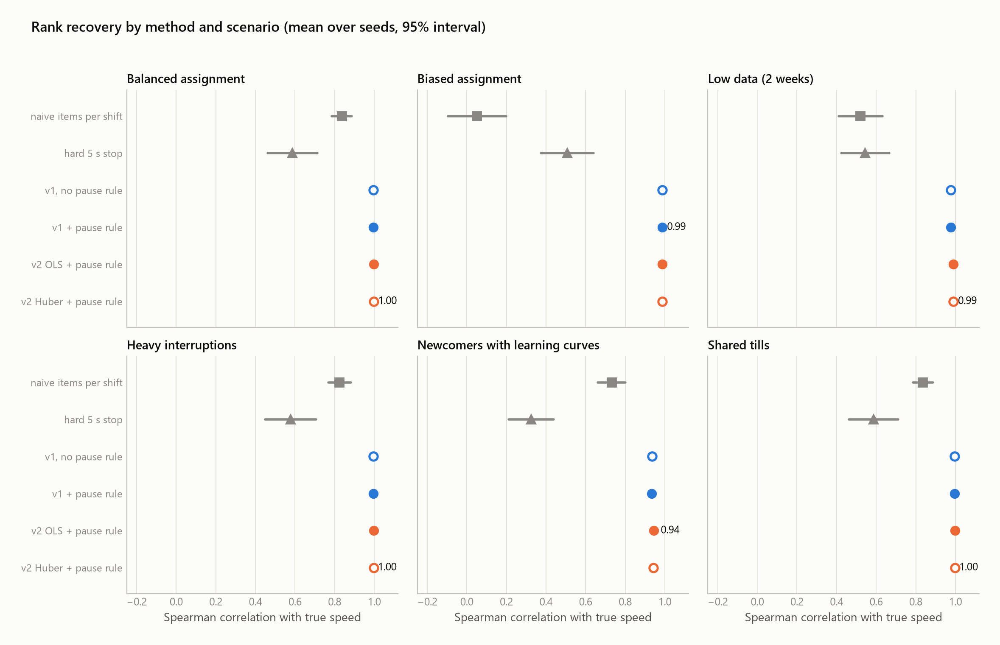

Where each method wins and loses (sections "Which method wins where" and "Default speed method" of the report):

- **The naive baseline wins nowhere.** It is closest when assignment is balanced and data is plentiful (0.84 against 0.998), and it collapses when strong cashiers are given easier work (0.05). The regression coefficient of average basket size on its score is 1.23 in that scenario, against 0.11 to 0.13 for v1 and v2 (section "Fairness: does the average basket size a cashier meets leak into the score?"): at the same true skill, the naive score is strongly driven by the basket size a cashier happened to get.
- **The hard 5 s stop never exceeds 0.59.** It is worst with newcomers (0.32), probably because more of their gaps are above the cutoff. In the scatter plot below (one balanced store) its estimates even turn back up for the slowest cashiers, whose long gaps are the ones it deletes.
- **v2 against v1.** v2 is better in five scenarios, by +0.002 (balanced), +0.002 (heavy interruptions), +0.010 (newcomers), +0.014 (2 weeks of data) and +0.002 (shared tills, which repeats the balanced speed result because only the cash sheet differs), each with a paired 95 percent interval that excludes 0, and tied in the biased scenario. v1 trails v2 by a practically relevant margin (0.005 or more) only with 2 weeks of data and with newcomers. Mean Spearman over the six scenarios is 0.9859 for v2 with OLS, 0.9857 with Huber and 0.9809 for v1, so v2 with OLS is the default (`docs/decisions.md`, D-33).
- **The pause rule shows no measurable benefit for v1** in any scenario (with and without it differ by 0.001 or less), presumably because the median is already robust. It was not ablated for v2.
- **Newcomers.** Scored against the speed they actually showed, v1 and v2 reach 0.99 (0.988 to 0.994); scored against their latent long-run skill, 0.93 to 0.94. Their learning curve is real signal, which is what the provisional label is for.

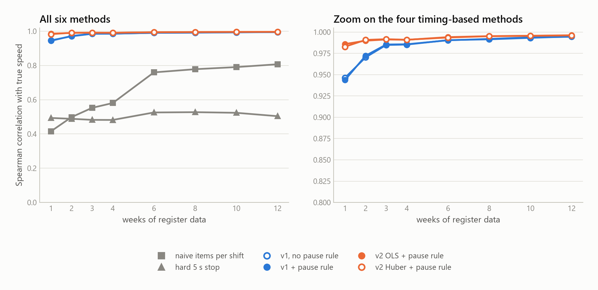

**Data volume** (section "Learning curve", balanced scenario): with one week of data v2 reaches 0.986 and v1 0.944, the naive baseline 0.415. At 12 weeks they reach 0.996, 0.994 and 0.807.

**Accuracy and shared tills** (section "Accuracy score with shared tills"): the accuracy score recovers the hidden error propensity with Spearman 0.850 in the balanced scenario and 0.829 when cashiers share drawers, using the cash-share split. Dropping shared drawers gives 0.871 and 0.847; the difference to the split (-0.021 and -0.018) is not distinguishable from zero over the seeds. Giving every named cashier the whole discrepancy is worse (0.819 and 0.791).

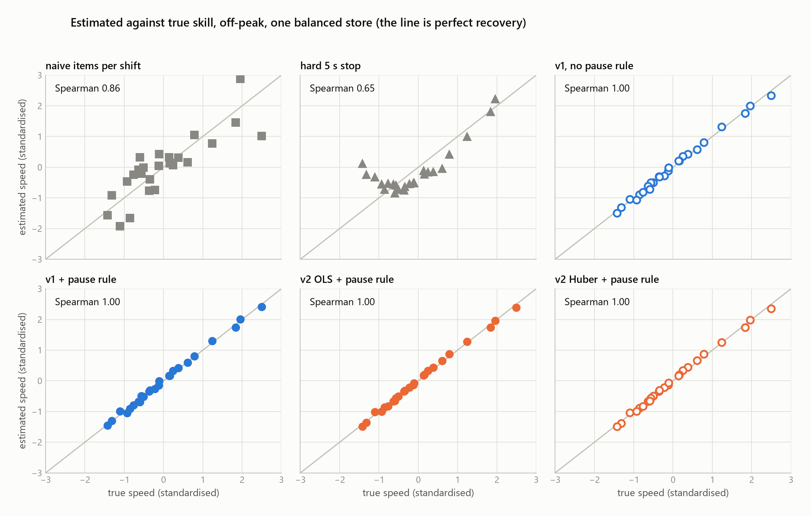

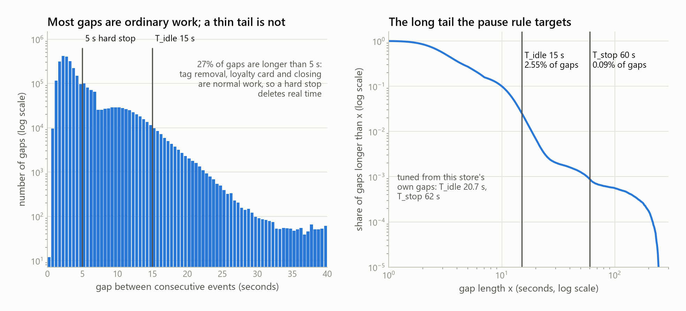

### How sure are the intervals?

Not sure enough, and the report says so (section "Interval calibration", `src/ree/experiments/calibration.py`). Twelve replicates of fresh data are simulated for the same hidden cashiers; a 90 percent interval is checked against the mean score on the other replicates. It contained that mean 78.7 percent of the time over 600 intervals (peak 78.0, off-peak 79.3), where a perfectly calibrated interval would score about 88.5 percent at this replicate count; the mean width is 5.7 points.

The ratio of the replicate-to-replicate spread of a score to its bootstrap standard error (1.0 would be calibrated) shows where the problem is: speed 1.14 off-peak and 1.07 at peak, accuracy 1.44 and the combined scores 1.44 and 1.42 (pooled over workers; medians are 1.05, 1.11, 1.19, 1.20 and 1.25). Resampling a cashier's own weeks cannot create a large mistake that never happened, so the accuracy intervals are too narrow. No inflation factor was applied. Tiers are conservative instead, and the limit is documented (`docs/decisions.md`, D-28).

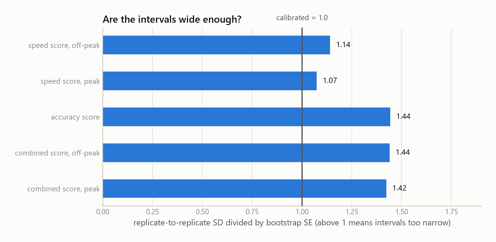

### Fairness audit

`src/ree/experiments/fairness.py` compares scores between groups at the same hidden skill; the test suite fails if the default store exceeds the configured limit (5 points) and a second test plants a 12-point bias to prove the audit catches it. Pooled over 10 stores (250 workers, a separate intercept per store, 95 percent intervals; section "Fairness audit by contract type and tenure"):

- Contract type: student and full-time workers do not differ. Every gap is within 0.3 points on the speed and combined scores and every interval includes zero (accuracy: -0.03 points, interval -2.08 to +2.02).
- Tenure, speed: workers with under 4 weeks of tenure (9 workers) score 4.6 points higher off-peak (interval 3.6 to 5.6) and 2.2 points higher at peak (1.4 to 3.1) than other workers who showed the same speed, and workers with 26 weeks or more score 1.9 and 1.0 points lower. Both are inside the limit. The cause is shrinkage toward the average, which stops thin data from burying a newcomer: with speed shrinkage switched off on the same stores, every tenure gap is within noise (newcomers -0.67 at peak and -0.44 off-peak, intervals including zero). The veterans' gap largely mirrors the lifted newcomers, because the comparison group contains them. A newcomer's displayed speed score is therefore optimistic; newcomers are labelled provisional and are not tiered against veterans.
- Tenure, accuracy and combined: no level gap is distinguishable from zero (combined scores differ by at most 1.7 points). The accuracy score does respond less steeply to true accuracy for thinner-data groups (relative slope gaps 0.71 for veterans and -0.40 for the 4 to 12 week band, above the per-store slope limit of 0.35); accuracy is the noisiest score and the groups are small, so these slopes are poorly determined. Worth watching, not resolved.

`docs/fairness.md` covers the French works council (CSE) and prior-information rules, GDPR (minimisation, automated decisions, impact assessment), indirect discrimination and the EU AI Act. They are engineering notes, not legal advice.

## What this does not prove

- **Nothing here is measured on a real store.** The store, the cashiers, the baskets, the timing, the errors and the cash discrepancies are simulated, and the parameters are my assumptions (`docs/decisions.md`, D-02 to D-15). A Spearman correlation of 0.99 means the engine recovers what the simulator planted under the simulator's own assumptions, not that it would on real registers.
- **The engine and the simulator share structure.** The simulator builds a transaction's time from a per-item part and a fixed part, which is the shape the v2 price list assumes, so v2's advantage over v1 is partly a match between model and generator. Real registers have effects this does not model, such as product-dependent scan times, bagging and queues.
- **Demand does not depend on cashier speed in the simulator** (D-12), so a faster cashier simply serves more customers. That flatters the naive items-per-shift baseline in the balanced scenario. In a real store where queues saturate, the baseline could look different.
- **Accuracy and combined intervals are too narrow** (about 1.4 times, 78.7 percent coverage against 88.5 percent). Speed intervals are close to calibrated. The tiers are conservative because of this, and no fudge factor was applied.
- **The pause rule is not ablated for v2**, and for v1 it shows no benefit in the simulator, where interruptions are generated in the way the thresholds assume.
- **The fairness audit needs the hidden skill**, which only a simulator has. On real data the comparison has to use proxies (basket mix, register, hours, period) and a human reading of any gap. The simulator plants no effect of contract type on skill, so a clean contract-type result is expected; what the audit shows is that the engine does not create one and that the check would catch one.
- **The tenure result is a designed trade-off**, not a measurement error: shrinkage lifts newcomers by 4.6 points off-peak in this study, and switching it off removes the gap. Shrinkage exists to steady scores built on thin data; this study prices its side effect but does not measure how much steadiness it buys.
- **Defaults are the method document's starting values** (idle 15 s, stop 60 s, shrinkage 150, weights 0.65 / 0.35 and 0.5 / 0.5, tolerance 1 euro). Only the speed method was chosen from the experiments. Nothing was tuned on real outcomes, and there are no real outcomes to tune on.
- **One store layout, one machine, no concept drift.** No seasonality of skill, no staff turnover beyond the newcomer scenario, no real queueing, no customer-facing effects of the scores.
- **The planner has its own limits**, listed in [What the planner does not prove](#what-the-planner-does-not-prove). One design consequence of Part 1: a planner that always gives strong cashiers the easy lanes would starve the engine of comparable data (the biased scenario shows what that does to naive measures), which is why the roster has a learning quota for provisional workers.
- **The legal notes are not legal advice.**

# Part 2: shift planner and daily coordinator

Part 2 turns demand forecasts and the Part 1 scores into a 3-week roster, a daily plan (posts, breaks, relief chain) and live proposals for the floor manager. The rule that organises it: **scores influence where and when someone works inside their contract, never how much**, and **every plan is a proposal** that a manager accepts, edits or rejects, with an independent checker that no solver can bypass.

Everything below is measured in a simulated store with assumed parameters. Read [What the planner does not prove](#what-the-planner-does-not-prove) before quoting any number. Two results shape how it should be read (see [Results (Part 2)](#results-part-2)): **the whole measured benefit of the scores comes from who stands at which register, not from the roster**, and **the first audit found that the roster was using the scores to buy hours and burden, which the principle forbids; that was fixed, and the audit now carries a negative control that reproduces the leak.**

## What it produces

1. **A roster** for the cycle (CP-SAT): contract hours exact within a 1-hour tolerance, rest, weekly rest, availability and the two always-open registers as hard rules; coverage of the Erlang C requirement first, then burden shared out across score tiers, a learning quota for provisional workers and stability against the last roster; the scores only choose between shifts of equal hours and equal burden. Every shift has a reason in plain words.
2. **A daily plan**: breaks inside their legal windows (at most 2 at once), posts for every 5-minute slot (strong workers on registers 1 and 4 in the rush), and the relief chain as an explicit list of who replaces whom and when.
3. **Live proposals**: every 5 minutes the busyness of the open registers is read; the planner proposes opening or closing a register, covers an absence and re-plans the rest of the day when the manager enters an event. Nothing changes until the manager accepts.
4. **A plan checker** (`src/ree/planner/checker`) that validates any roster or daily plan, including manual edits, and an **audit log** of every plan version, override and proposal with its outcome.
5. **A posts-only mode** (`objective.scores_in_roster: false`, `--posts-only`, `posts_only` in the API, a checkbox in the manager screen): the roster ignores the scores altogether, the daily plan still uses them to choose who stands at which register. In the evaluated runs it gives the same roster as the default mode; it guarantees by configuration what the default guarantees by construction.

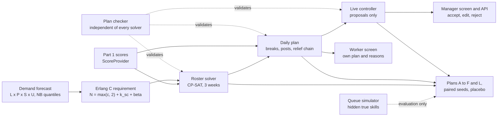

## Quickstart (Part 2)

After `uv sync --all-groups` (the same install as Part 1; OR-Tools is a normal dependency and installs on Windows):

```bash
uv run python -m ree.cli planner smoke                  # foundation, Erlang C, simulator, roster, daily plan, API: about 35 seconds
uv run python -m ree.cli planner roster --store small
uv run python -m ree.cli planner roster --store small --posts-only
uv run python -m ree.cli planner daily --store small --day 2026-11-05
uv run python -m ree.cli planner ui                     # manager screen; add --worker for the worker screen
uv run python -m ree.cli planner api                    # FastAPI service, docs at http://127.0.0.1:8001/docs
uv run python -m ree.cli planner roster-gate            # 50 seeded rosters through the checker, about 3 minutes
uv run python -m ree.cli planner queue-check            # simulator against Erlang C
uv run python -m ree.cli planner evaluate --jobs 4      # plans A to F and L, about 25 minutes on 8 cores
uv run python -m ree.cli planner audit --jobs 4         # fairness audit, about 10 minutes on 8 cores
uv run python -m ree.cli planner stability              # re-solve stability, a few minutes
uv run pytest -m "not gate"                             # everything except the 3-minute roster gate
```

Planner settings live in `config/planner.yaml` and `config/shift_patterns.yaml`, generated from the code defaults and kept equal to them by a test. Labour rules are parameters with defaults, each marked "confirm with HR" (`docs/labour_rules.md`, below). Windows needs nothing but Python and uv: no make, bash or symlinks.

## Results (Part 2)

All of it comes from a simulated store with assumed parameters (see [What the planner does not prove](#what-the-planner-does-not-prove)). Each heading names the command that produces the numbers; the full tables are in `outputs/planner/reports/`.

### The roster solver: 50 seeded scenarios (`planner roster-gate`)

50 of 50 rosters pass the plan checker with no error and no relaxed rule (10 cashiers, one week, deterministic CP-SAT). Largest hours deviation from a contract 1.0 h (the tolerance), mean uncovered staff time 16.8 minutes per scenario, 141 seconds on 8 cores. The same inputs give the same roster whatever the machine load (the objective and status of all 50 seeds were identical under 4 and under 8 processes). The largest score-tier burden gap is 48.7 percent, above the limit of 35: the top and bottom tiers of a 10-worker store have 2 workers each, so a chance gap of that size is expected and the limit is checked on the 24-worker store by the audit and the evaluation instead (`roster_gate.json`).

### The queue simulator against Erlang C (`planner queue-check`)

With one shared queue the simulated mean wait is within 1.6 percent of the Erlang C value for 2 to 8 registers. With one line per register, as in the simulated store, waits are 11 to 73 percent longer than Erlang C, the more so the more registers. The planner plans with Erlang C and is evaluated on the store with lines, so absolute waits are not comparable with the 3-minute target; only the comparison between plans is meaningful.

### Which plan waits least (`planner evaluate`)

24 cashiers with Part 1 scores, about 6064 customers a week, 8 simulated workforces (each with its own Part 1 store and hidden speeds), 5 repetitions of each week, six scenarios. Intervals are 95 percent bootstrap intervals over the 8 seeds.

Normal week, mean over seeds:

| Plan | Mean wait (s) | 95th percentile (s) | Waited over 3 min or left (%) | Left without service (%) | Customers waiting per open register |
|---|---|---|---|---|---|
| A headcount only | 38.2 [35.0, 42.1] | 181 [169, 197] | 12.1 [11.0, 13.6] | 7.9 [7.3, 8.7] | 0.23 [0.21, 0.25] |
| B demand-aware, no scores | 24.4 [21.8, 28.2] | 136 [124, 153] | 7.3 [6.3, 8.8] | 5.1 [4.5, 6.0] | 0.13 [0.12, 0.15] |
| F scores in the posts only | 21.5 [18.9, 25.3] | 123 [112, 141] | 6.2 [5.2, 7.7] | 4.5 [3.9, 5.3] | 0.12 [0.10, 0.14] |
| C full planner | 21.4 [18.9, 25.2] | 123 [112, 141] | 6.2 [5.2, 7.6] | 4.5 [3.9, 5.3] | 0.12 [0.10, 0.14] |
| D oracle (true skills) | 20.4 [18.0, 23.9] | 119 [108, 135] | 5.8 [4.9, 7.2] | 4.3 [3.7, 5.1] | 0.11 [0.10, 0.13] |
| E placebo (shuffled scores) | 24.7 [22.0, 28.6] | 136 [124, 154] | 7.3 [6.3, 8.8] | 5.1 [4.5, 6.0] | 0.13 [0.12, 0.16] |
| L full planner with live re-planning | 22.4 [19.7, 26.0] | 127 [115, 144] | 6.5 [5.5, 7.9] | 4.7 [4.1, 5.5] | 0.12 [0.10, 0.14] |

Paired differences in the mean wait, in seconds (below zero is better for the first plan):

| Comparison | normal week | Saturday surge | absences | season peak | forecast error | small team | Scenarios lower / no clear difference / higher |
|---|---|---|---|---|---|---|---|
| B minus A | -13.8 [-18.1, -9.7] | -19.4 [-24.2, -15.0] | -15.5 [-19.5, -11.3] | -2.3 [-3.4, -1.0] | -14.6 [-19.5, -10.4] | -1.6 [-8.4, +4.7] | 5 / 1 / 0 |
| F minus B | -2.9 [-3.3, -2.6] | -3.5 [-4.0, -3.0] | -3.6 [-4.4, -2.9] | -2.2 [-2.9, -1.5] | -3.2 [-4.0, -2.6] | -1.9 [-2.4, -1.3] | 6 / 0 / 0 |
| C minus F | -0.0 [-0.1, +0.0] | +0.0 [-0.0, +0.1] | -0.1 [-0.1, +0.0] | +0.0 [-0.0, +0.1] | -0.0 [-0.1, +0.0] | +0.0 [+0.0, +0.1] | 0 / 6 / 0 |
| C minus B | -3.0 [-3.3, -2.6] | -3.5 [-4.0, -2.9] | -3.6 [-4.5, -2.9] | -2.2 [-2.9, -1.5] | -3.3 [-4.1, -2.7] | -1.9 [-2.4, -1.3] | 6 / 0 / 0 |
| E minus B | +0.3 [-0.1, +0.6] | +0.2 [-0.3, +0.7] | +0.5 [-0.5, +1.4] | -0.2 [-0.9, +0.3] | +0.1 [-0.4, +0.5] | +0.2 [-0.7, +1.2] | 0 / 6 / 0 |
| C minus E | -3.2 [-3.7, -2.7] | -3.7 [-4.5, -2.9] | -4.1 [-5.1, -3.2] | -1.9 [-2.4, -1.4] | -3.4 [-3.9, -2.8] | -2.1 [-2.9, -1.3] | 6 / 0 / 0 |
| D minus C | -1.0 [-1.3, -0.8] | -1.3 [-1.8, -0.8] | -1.5 [-2.2, -0.9] | -1.4 [-1.8, -1.0] | -1.0 [-1.4, -0.7] | -1.3 [-1.7, -0.9] | 6 / 0 / 0 |
| L minus C | +1.0 [+0.5, +1.6] | -0.7 [-1.5, +0.2] | -3.6 [-4.6, -2.5] | +0.1 [-0.4, +0.6] | -0.3 [-1.2, +0.7] | -0.0 [-0.4, +0.4] | 1 / 4 / 1 |

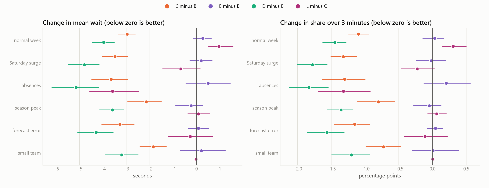

What it says, in the normal week:

- Planning from the forecast (B) cuts the mean wait by 13.8 s against headcount only (A) (-13.8 [-18.1, -9.7]); it is the larger effect and holds in 5 of 6 scenarios. Plan A is a stylised stand-in for today's practice, not calibrated on real data.
- Adding the Part 1 scores (C against B) cuts it by a further 3.0 s (-3.0 [-3.3, -2.6]), in 6 of 6 scenarios.
- The placebo (E, the same plan with the scores shuffled across workers) is not better than B (+0.3 [-0.1, +0.6]), and C is better than E in 6 of 6 scenarios: the gain comes from the scores themselves, not from the shape of the plan.
- The oracle (D, true skills as scores) is a further 1.0 s better than C (-1.0 [-1.3, -0.8]): the Part 1 scores capture part of what the planner could use, not all of it.
- The advantage of C over B depends on the layout of the simulated store: -2.7 [-3.1, -2.3] s with no customer preference for the registers near the entrance, -3.0 [-3.3, -2.6] s with the preference used here, -3.5 [-4.0, -3.0] s with a stronger one.
- Scores used only to choose who stands at which register (F) lower the mean wait against plan B in 6 of 6 scenarios, with no clear difference in 0 and higher in 0. Adding the roster use of the scores (C against F) lowers it further in 0, with no clear difference in 6 and higher in 0. In the normal week F captures 99% of the mean-wait reduction of C. Most of the gain comes from choosing who stands at which register; using the scores in the roster as well does not add a gain that shows in most scenarios. Plan F keeps the roster of plan B, so it carries none of the effects of the scores on who works which shift.
- Registers are idle 34 to 42 percent of their open time in the normal week, whichever plan is used, and an open register has more than 5 customers waiting for no more than 0.2 percent of the open day. The evaluation does not price staff time.
- Live re-planning (manager accepts every proposal): mean wait lower than the static plan in 1 of 6 scenarios, no clear difference in 4, higher in 1; share waiting over 3 minutes or leaving lower in 1, no clear difference in 4, higher in 1. A register was opened and closed again (or the reverse) 7.12 times per week on average. The result is mixed: the mean wait is lower in the absences scenario and higher in the normal week scenario. This simulation does not show that accepting every proposal beats the static plan; the proposals are decision support for a manager who can decline them.

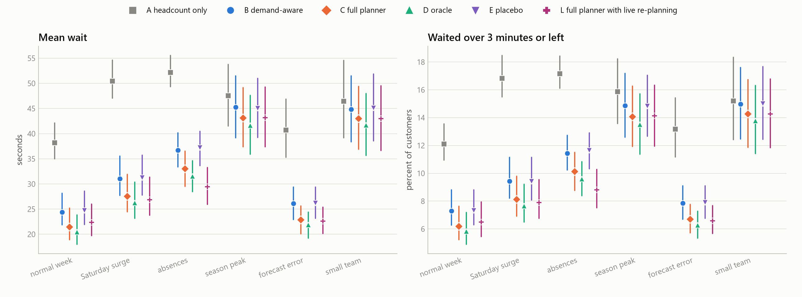

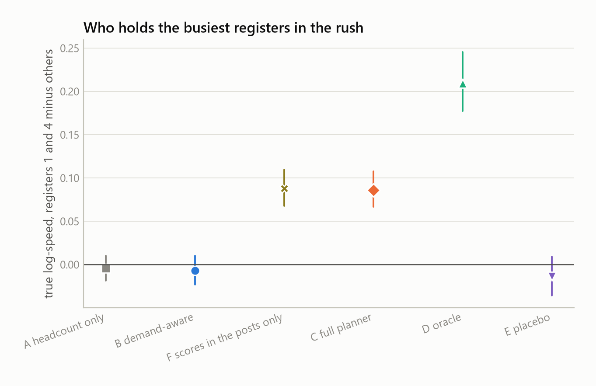

### The fairness audit (`planner audit`)

6 simulated workforces; plan C and its variants (noisy scores, no learning quota, and a negative control with the first version's hours-changing swaps), the score-blind plan B and the placebo E, all under the same coverage. Full table in `fairness_audit.md`.

- Hours and pay: the largest deviation from a contract is 1.00 h in every variant (tolerance 1.0 h), and the largest difference between a worker's weekly paid hours in any variant (the negative control apart) and in plan B is 0.00 h.
- Burden guard: the largest score-tier burden gap in plan C and its variants is 0.307 against a limit of 0.35.
- Tier gap: plan C's largest tier gap is above plan B's in 0 of 6 seeds (mean difference +0.000).
- Score against burden per paid hour: plan C -0.06 (below zero in 4 of 6 seeds), plan B -0.06, placebo E -0.06. A value below zero means that workers with higher scores carry less of it.
- Score against share of late shifts: plan C +0.00 (below zero in 3 of 6 seeds), plan B +0.00, placebo E -0.00. A value below zero means that workers with higher scores carry less of it.
- Hours: the correlation of the score with the signed deviation of paid hours from the contract (inside the tolerance of 1.0 h) is -0.03 in plan C, -0.03 in plan B and -0.03 in the placebo E; paid minus contract hours of tier A minus those of tier C: +0.01 h a week in plan C.
- What the scores change: against plan B, plan C moves 0 worker-days (a person working on a day when plan B does not) and gives a different shift of the day to 0% of its shifts. The correlations of the score with the weekend share and with the split share are the same in every variant.
- Negative control: when shifts of different length and burden may be swapped (`objective.neutral_swaps: false`, the behaviour of the first version), the correlation of the score with the hours deviation is +0.51 and tier A minus tier C is +1.27 h a week, so the audit detects a score that buys hours; the default swaps (equal hours, equal burden) show -0.03 and +0.01 h.
- Learning quota (a floor of 90 rush minutes a week for each new worker): new workers get 638 rush minutes a week in plan C, and the roster without the quota is identical to plan C in every seed, so the quota does not bind here and this audit cannot show what it does.
- Noise in the scores: with normal noise of 0.25, 0.5, 1.0 (in z units) added to the scores the planner sees, 100%, 100%, 100% of plan C's shifts survive, so in these seeds the roster does not respond to the scores at all.
- Restricted availability: the correlation of the number of blocked days with burden per paid hour is +0.31 in plan B (no scores), +0.31 in plan C and +0.32 in the placebo E: workers with more blocked days carry a heavier burden in every plan, the score-blind one included, so this is not an effect of the scores and it has not been removed.

### Re-solving after a change (`planner stability`)

Blocking 2 worker-days of a solved one-week roster of 48 assignments and solving again changes 28 assignments on average when the previous roster is given as the stability reference (a priced term of 15 per changed assignment) and 53 when it is not; a shift that moves to another day counts twice. The reference removes 251 of 531 changes (47%). A repair that moved only the blocked shifts and the few that take them over would change a handful of assignments, so at this search budget the solver does not stay close to the previous roster; a repair mode that fixes everything outside a neighbourhood of the change is not built.

### What this means for a pilot

- Use the scores where they pay: who stands at which register. In this simulation that alone keeps 99% of the mean-wait reduction of the full planner in the normal week.
- Keep the roster score-blind in hours and burden. The default does it by construction and the audit's negative control shows what happens when it does not; posts-only mode does it by configuration and gives the same roster in these runs.
- Do not rely on the stability term or the learning quota until they are shown to work on a real store, and do not read the tier guard as a guarantee.

## Labour rules (parameters, not legal claims)

Every rule is a parameter in `config/planner.yaml` (section `rules`) and the checker enforces exactly these values on every plan. None is legal advice; HR, the collective agreement and the works council must confirm or change each default before any real use. The full table, with the meaning and status of each parameter, is generated by `python -m ree.cli planner labour-rules` and kept in `docs/labour_rules.md`. The ones that shape the plans:

| Rule | Default |
| --- | --- |
| Rest between two shifts | 11 hours |
| Weekly rest | 35 consecutive hours (a full day inside the Sunday to Saturday week) |
| Consecutive working days | at most 6 |
| Weekly paid hours around the contract | within 1 hour |
| Shift block | at least 3 hours, at most one cut per day (1 hour, up to 1 hour 30) |
| Break | 3 minutes per hour worked, rounded up to 5, paid, centred on the block (30 minutes of tolerance, moved by at most 90) |
| Breaks at once | 2 (3 only as a flagged limit case) |
| Clock-in and clock-out | 10 minutes before and 5 minutes after the register time, both paid |
| Sunday work | mandatory, in the burden rotation |

## What the planner does not prove

- **Simulated store.** Arrivals follow the forecast model with negative binomial noise, service times follow the structure of the Part 1 simulator, and the hidden speeds are the Part 1 ground truth. A real store may behave differently; the first real test is a pilot with real tickets and real rosters.
- **The planning model and the store disagree.** Erlang C assumes one shared queue. The simulated store has one line per register and customers prefer the registers near the entrance. Waits there are 11 to 73 percent longer than Erlang C (`planner queue-check`), so only the comparison between plans is meaningful, not the absolute waits against the 3-minute target. The advantage of putting the fastest cashiers on registers 1 and 4 depends on that preference; the report shows the result without it.
- **Plan A is a stylised stand-in** for today's practice, not calibrated on real data. Self-checkout customers are not simulated, and the live evaluation assumes a manager who accepts every proposal.
- **Few seeds.** Eight simulated workforces for the evaluation, six for the fairness audit and ten for the stability probe give wide intervals; a difference that is not clearly different from zero is reported as such.
- **The roster use of the scores does nothing measurable.** Swaps are limited to shifts of equal hours and equal burden, and in the audit the roster that the scores produce equals the score-blind roster; the evaluation cannot separate plan C from plan F, so the whole measured gain comes from the posts. Hours and burden are protected by construction, but the tier guard is a limit, not an equality: in the stress scenarios a gap above the limit remained in 1 of 8 seeds (`evaluation.md`).
- **The learning quota is not shown to work.** In the audit it never binds (new workers already get far more rush time than the floor) and the roster without it is identical, so the audit cannot show what it does.
- **Restricted availability goes with a heavier burden in every plan, the score-blind one included.** The planner never penalises availability and treats blocked time as a hard constraint, but the audit finds the association, and it has not been removed.
- **Stability is weak.** The stability term is in the model, but at this search budget the solver does not stay close to the previous roster when a worker-day is blocked (`planner stability`). A repair mode is not built, and the evaluation plans one week from scratch, so it does not measure stability.
- **Contract hours are fixed in every plan**, so the comparison says nothing about cost; registers are idle for a large share of their open time in every plan.
- **Labour rules are assumptions** to be confirmed (see the table above). The planner never states a legal claim as fact.
- **Not built:** the joint CP-SAT version of the daily plan, paired shadow roles for provisional workers at the register, a roster repair mode, real-time register events (the live controller is fed busyness readings; in the simulation they come from the simulated registers), authentication, and persistence of the current roster across restarts.

## What a real pilot would need

- **Real data.** Register timestamps and tickets to fit the demand model (`demand/forecast.py` already fits level, profile and dispersion from history) and the service time; real rosters, contracts and blocked time windows (never the reasons); the real queue behaviour at the registers, to replace the simulated line-choice rule and to measure the gap to Erlang C.
- **Rules confirmed.** Every labour-rule default confirmed or changed by HR and the collective agreement, and the works council (CSE) informed and consulted, as for Part 1 (`docs/fairness.md`), before scores are used on real people. Workers informed beforehand; the appeal route of Part 1 stays open.
- **Decide whether the roster stays score-blind.** Posts-only mode keeps the scores out of the roster by configuration; measure on real data whether the equal-hours, equal-burden swaps ever add anything before keeping them.
- **Part 1 on real data first.** The planner is only as fair as the scores and tiers it reads.
- **Shadow mode.** Run the planner next to the manager's own roster, compare, and measure how often proposals are accepted and whether waits and queue lengths improve, before any plan is used.
- **Not built, needed for production:** authentication and roles for the screens and the API, persistence of the current roster, a feed of real register events for the live controller, and a roster repair mode so that a change does not reshuffle the week.

## Decisions and fairness

`docs/planner_decisions.md` lists every default and every departure from the method document (P-01 onwards); `docs/fairness_planner.md` says what scores may and may not influence, which test holds each line, and what the audit found. The planner method is in `docs/method_planner.md`, the labour-rule parameters in `docs/labour_rules.md`, and the decisions of Part 1 in `docs/decisions.md`.

## Repository map

| path | contents |
| --- | --- |
| `src/ree/simulator/` | workers with hidden skill, scheduler, baskets, transactions and events, cash sheet |
| `src/ree/engine/` | pause rule, features, speed v1 and v2, shrinkage, accuracy, combine, bootstrap intervals, tiers, drivers, pipeline |
| `src/ree/storage/db.py` | SQLite and parquet storage, with a connection that cannot read the ground truth |
| `src/ree/api/` | FastAPI app, `ScoreProvider` protocol and its in-memory implementation |
| `src/ree/ui/` | Streamlit review screen and its headless smoke check |
| `src/ree/experiments/` | methods, scenarios, metrics, calibration, fairness audit, figures, report |
| `src/ree/planner/domain/`, `demand/`, `staffing/` | shift patterns and rules, demand forecast, Erlang C requirement |
| `src/ree/planner/checker/` | the plan checker, independent of every solver |
| `src/ree/planner/roster/` | CP-SAT roster model and solver, fallback, score refinement, fairness metrics, explanations |
| `src/ree/planner/daily/`, `live/` | breaks, posts, relief chain, live controller and proposals |
| `src/ree/planner/sim/`, `eval/` | queue simulator, Part 1 workforce, scenarios, plans A to F and L, report, figures, fairness audit, stability probe |
| `src/ree/planner/api/`, `ui/` | planner service, FastAPI app, audit log, manager and worker screens |
| `tests/`, `tests/planner/` | unit, property, determinism, API, screen, fairness and regression tests |
| `config/default.yaml` | Part 1 settings, generated from the code defaults |
| `config/planner.yaml`, `config/shift_patterns.yaml` | planner settings, generated from the code defaults |
| `docs/method_scoring.md`, `docs/method_planner.md` | the scoring method and the planner method |
| `docs/decisions.md`, `docs/planner_decisions.md` | every default and assumption, with reason and how to change it |
| `docs/fairness.md`, `docs/fairness_planner.md` | safeguards and audits: French labour law, GDPR and the EU AI Act for Part 1; the line scores may not cross for the planner |
| `docs/labour_rules.md` | labour-rule parameters, each to be confirmed with HR |
| `docs/openapi.json`, `docs/planner_openapi.json` | API schemas |
| `outputs/figures/`, `outputs/reports/` | Part 1 figures and `results.md` with per-seed CSVs |
| `outputs/planner/` | roster gate report, evaluation report with figures, fairness audit, stability probe |
| `.github/workflows/ci.yml` | continuous integration: install, lint, tests |
| `Makefile`, `pyproject.toml`, `uv.lock` | commands, packaging, pinned dependencies |

## Reproducibility

Every random process takes its seed from the configuration, so one command reproduces every figure and number, and `uv.lock` pins the versions of every dependency. A scoring run writes a byte-identical `scores.json` when repeated (tested, and checked by `smoke`); `model_version` combines the package version with hashes of the scoring configuration and the engine source, and `computed_at` is the as-of time of the data, so wall-clock time exists only in the audit log. The planner is deterministic too: the roster solver runs on a deterministic-time budget (identical results for the same inputs, whatever the load; checked by running the 50-scenario gate under two different process counts), every random draw of the simulation comes from the configured seed, and `planner evaluate` and `planner audit` write the same files when repeated.

© 2026 Farham Fakouri. All rights reserved.
