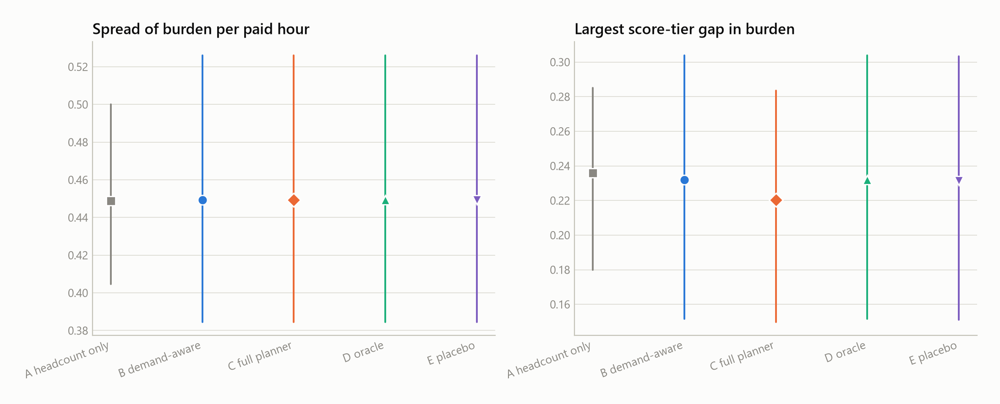
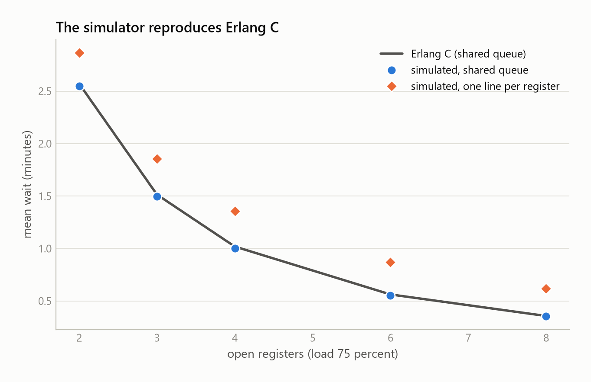

# Planner evaluation

Generated by `python -m ree.cli planner evaluate` (or `planner report` from the saved results). Every number below is computed from `results.csv` next to this file.

## Set-up

- Store: `eval`, 24 cashiers with Part 1 scores, about 6064 customers in a week, one week of 7 days per run.
- 8 seeds. Each seed draws a Part 1 store (hidden speeds and the scores Part 1 derives from simulated registers), a workforce with contracts and availability, and 5 repetitions of the week's customers. Results are averaged over the repetitions of a seed; intervals are 95 percent bootstrap intervals over seeds (2000 resamples).
- Plans: A headcount only (the same registers open in every rush slot and in every calm slot), B demand-aware (forecast and Erlang C requirement, no scores), C the full planner (B with Part 1 scores in the posts and, in the roster, only through swaps of shifts with equal hours and equal burden, the tier guard and the learning quota), D the oracle (B with the hidden true speeds as scores), E the placebo (B with the Part 1 scores shuffled across workers), F the ablation (the roster of B with the Part 1 scores used only to choose who stands at which register, so it separates what the scores add in the posts from what they add in the roster).
- Coverage-first solving: for plans B to E the roster is first solved for coverage alone, with no scores, so all four have the same coverage; a second stage then keeps every worker's weekly paid minutes and the coverage and optimises burden, the tier guard and the learning quota, so no plan gives anyone different hours.
- Scenarios: normal week (the forecast is right on average); Saturday surge (Saturday brings 30 percent more customers); absences (8 percent of rostered shifts are missed); season peak (the week from 20 December with bigger baskets); forecast error (the real demand level differs from the forecast by a random 15 percent); small team (a quarter of the cashiers are missing).

## Waiting times (mean over seeds, 95 percent interval in brackets)

| Scenario | Plan | Mean wait (s) | 95th percentile wait (s) | Waited over 3 min or left (%) | Left without service (%) | Rush mean wait (s) |
|---|---|---|---|---|---|---|
| normal week | A headcount only | 38.2 [35.0, 42.1] | 181.2 [169.0, 197.0] | 12.10 [10.95, 13.55] | 7.94 [7.34, 8.73] | 30.3 [26.8, 34.8] |
| normal week | B demand-aware | 24.4 [21.8, 28.2] | 135.6 [124.0, 153.2] | 7.29 [6.27, 8.81] | 5.13 [4.52, 6.01] | 19.4 [16.4, 24.0] |
| normal week | C full planner | 21.4 [18.9, 25.2] | 123.3 [111.9, 140.7] | 6.19 [5.22, 7.64] | 4.48 [3.92, 5.31] | 17.1 [14.0, 21.8] |
| normal week | D oracle | 20.4 [18.0, 23.9] | 118.6 [107.8, 134.8] | 5.84 [4.90, 7.19] | 4.28 [3.72, 5.09] | 16.5 [13.4, 21.1] |
| normal week | E placebo | 24.7 [22.0, 28.6] | 136.3 [124.3, 154.0] | 7.32 [6.28, 8.81] | 5.12 [4.54, 5.95] | 19.6 [16.3, 24.4] |
| normal week | L full planner with live re-planning | 22.4 [19.7, 26.0] | 126.7 [114.9, 143.8] | 6.50 [5.46, 7.94] | 4.65 [4.05, 5.48] | 19.2 [15.8, 24.0] |
| Saturday surge | A headcount only | 50.5 [47.1, 54.6] | 222.6 [208.5, 240.7] | 16.83 [15.49, 18.46] | 10.48 [9.81, 11.32] | 42.4 [38.8, 47.1] |
| Saturday surge | B demand-aware | 31.0 [27.7, 35.6] | 155.3 [142.3, 173.8] | 9.44 [8.21, 11.15] | 6.46 [5.78, 7.39] | 26.7 [23.0, 31.7] |
| Saturday surge | C full planner | 27.5 [24.4, 31.9] | 143.1 [129.6, 162.5] | 8.12 [6.93, 9.80] | 5.70 [5.06, 6.57] | 23.8 [20.1, 28.7] |
| Saturday surge | D oracle | 26.2 [23.2, 30.4] | 137.3 [124.0, 155.8] | 7.66 [6.49, 9.22] | 5.44 [4.79, 6.29] | 22.9 [19.3, 27.7] |
| Saturday surge | E placebo | 31.2 [27.8, 35.7] | 155.5 [141.7, 174.2] | 9.42 [8.08, 11.14] | 6.44 [5.72, 7.38] | 26.8 [23.0, 31.7] |
| Saturday surge | L full planner with live re-planning | 26.9 [23.8, 31.4] | 141.4 [128.7, 160.5] | 7.89 [6.76, 9.54] | 5.57 [4.95, 6.42] | 24.8 [21.1, 29.8] |
| absences | A headcount only | 52.2 [49.3, 55.5] | 229.6 [217.0, 243.2] | 17.15 [16.11, 18.42] | 10.90 [10.38, 11.51] | 41.4 [38.1, 45.3] |
| absences | B demand-aware | 36.7 [33.4, 40.1] | 180.4 [165.8, 196.8] | 11.43 [10.24, 12.74] | 7.57 [6.93, 8.26] | 28.8 [25.7, 32.3] |
| absences | C full planner | 33.0 [29.5, 36.5] | 166.1 [149.9, 183.0] | 10.13 [8.76, 11.51] | 6.85 [6.11, 7.59] | 25.5 [22.2, 29.6] |
| absences | D oracle | 31.5 [28.5, 34.6] | 159.4 [145.1, 174.3] | 9.60 [8.40, 10.84] | 6.55 [5.92, 7.24] | 24.6 [21.5, 28.2] |
| absences | E placebo | 37.2 [33.6, 40.5] | 181.8 [166.3, 197.6] | 11.63 [10.32, 12.90] | 7.67 [6.98, 8.31] | 29.2 [26.2, 32.6] |
| absences | L full planner with live re-planning | 29.4 [25.9, 33.2] | 151.3 [136.6, 168.1] | 8.81 [7.52, 10.29] | 6.08 [5.36, 6.91] | 24.9 [20.8, 29.5] |
| season peak | A headcount only | 47.6 [41.5, 53.8] | 227.1 [201.7, 253.8] | 15.86 [13.57, 18.22] | 9.96 [8.67, 11.30] | 43.1 [35.9, 50.3] |
| season peak | B demand-aware | 45.3 [39.1, 51.5] | 220.5 [194.2, 247.9] | 14.87 [12.60, 17.18] | 9.42 [8.15, 10.72] | 44.3 [37.5, 51.2] |
| season peak | C full planner | 43.1 [37.4, 49.2] | 213.5 [188.0, 240.7] | 14.07 [11.93, 16.26] | 8.97 [7.78, 10.23] | 42.6 [36.1, 49.1] |
| season peak | D oracle | 41.7 [35.9, 47.6] | 209.6 [183.5, 237.6] | 13.51 [11.36, 15.71] | 8.66 [7.46, 9.89] | 41.3 [34.7, 47.9] |
| season peak | E placebo | 45.0 [39.2, 51.0] | 219.4 [194.8, 245.7] | 14.82 [12.66, 17.06] | 9.40 [8.20, 10.66] | 44.1 [37.6, 50.7] |
| season peak | L full planner with live re-planning | 43.2 [37.4, 49.3] | 213.6 [188.1, 241.0] | 14.13 [11.95, 16.34] | 9.00 [7.76, 10.29] | 43.3 [36.9, 49.8] |
| forecast error | A headcount only | 40.7 [35.3, 46.9] | 186.0 [168.9, 208.1] | 13.17 [11.16, 15.42] | 8.56 [7.37, 9.84] | 32.8 [27.4, 39.3] |
| forecast error | B demand-aware | 26.1 [22.9, 29.4] | 136.3 [125.3, 149.3] | 7.85 [6.69, 9.10] | 5.53 [4.79, 6.29] | 21.2 [17.8, 24.8] |
| forecast error | C full planner | 22.9 [20.1, 25.6] | 123.9 [113.8, 136.5] | 6.69 [5.71, 7.77] | 4.84 [4.20, 5.48] | 18.4 [15.3, 21.9] |
| forecast error | D oracle | 21.8 [19.2, 24.4] | 119.2 [109.8, 130.4] | 6.28 [5.34, 7.28] | 4.58 [3.95, 5.20] | 17.8 [14.8, 21.1] |
| forecast error | E placebo | 26.2 [23.2, 29.4] | 137.5 [126.5, 150.8] | 7.89 [6.76, 9.09] | 5.54 [4.82, 6.31] | 21.1 [17.8, 24.7] |
| forecast error | L full planner with live re-planning | 22.6 [20.1, 25.4] | 123.8 [114.4, 136.5] | 6.58 [5.67, 7.67] | 4.80 [4.23, 5.42] | 19.6 [16.4, 23.2] |
| small team | A headcount only | 46.4 [39.2, 54.6] | 205.9 [179.4, 235.3] | 15.20 [12.43, 18.33] | 9.69 [8.21, 11.33] | 43.0 [33.6, 53.2] |
| small team | B demand-aware | 44.9 [38.4, 51.5] | 213.8 [187.0, 241.2] | 14.98 [12.47, 17.61] | 9.46 [8.17, 10.78] | 46.9 [38.2, 55.7] |
| small team | C full planner | 43.0 [36.9, 49.4] | 208.0 [181.4, 235.6] | 14.25 [11.87, 16.74] | 9.01 [7.77, 10.28] | 45.2 [36.8, 53.7] |
| small team | D oracle | 41.7 [35.6, 48.0] | 202.7 [176.2, 229.3] | 13.78 [11.40, 16.32] | 8.75 [7.51, 10.08] | 44.0 [35.8, 52.4] |
| small team | E placebo | 45.1 [38.5, 51.9] | 213.1 [186.7, 240.6] | 14.99 [12.44, 17.67] | 9.42 [8.14, 10.82] | 47.1 [38.5, 56.1] |
| small team | L full planner with live re-planning | 43.0 [36.7, 49.5] | 207.7 [180.6, 235.3] | 14.26 [11.84, 16.78] | 9.03 [7.79, 10.32] | 46.0 [37.5, 54.5] |

## Queue length and idle capacity

The manager tolerates no more than 5 customers waiting at every open register. The table gives the average number of customers waiting per open register, the share of the open day in which some open register had more than 5 waiting, and the share of open-register time spent idle.

| Scenario | Plan | Customers waiting per open register | Open day with more than 5 waiting at a register (%) | Idle share of open-register time (%) |
|---|---|---|---|---|
| normal week | A headcount only | 0.23 [0.21, 0.25] | 0.2 [0.1, 0.3] | 33.7 [32.8, 34.6] |
| normal week | B demand-aware | 0.13 [0.12, 0.15] | 0.1 [0.0, 0.2] | 38.6 [37.6, 39.5] |
| normal week | C full planner | 0.12 [0.10, 0.14] | 0.1 [0.0, 0.2] | 40.8 [39.8, 41.7] |
| normal week | D oracle | 0.11 [0.10, 0.13] | 0.1 [0.0, 0.2] | 41.6 [40.6, 42.6] |
| normal week | E placebo | 0.13 [0.12, 0.16] | 0.1 [0.0, 0.2] | 38.4 [37.5, 39.3] |
| normal week | L full planner with live re-planning | 0.12 [0.10, 0.14] | 0.1 [0.0, 0.2] | 40.8 [40.0, 41.5] |
| Saturday surge | A headcount only | 0.32 [0.30, 0.35] | 0.4 [0.2, 0.6] | 31.5 [30.7, 32.3] |
| Saturday surge | B demand-aware | 0.18 [0.16, 0.21] | 0.1 [0.0, 0.2] | 35.6 [34.7, 36.7] |
| Saturday surge | C full planner | 0.16 [0.14, 0.19] | 0.1 [0.0, 0.2] | 37.8 [36.9, 38.7] |
| Saturday surge | D oracle | 0.15 [0.13, 0.18] | 0.1 [0.0, 0.2] | 38.5 [37.6, 39.5] |
| Saturday surge | E placebo | 0.18 [0.16, 0.21] | 0.1 [0.0, 0.2] | 35.5 [34.6, 36.4] |
| Saturday surge | L full planner with live re-planning | 0.15 [0.13, 0.18] | 0.1 [0.0, 0.2] | 38.4 [37.6, 39.2] |
| absences | A headcount only | 0.34 [0.31, 0.36] | 1.0 [0.8, 1.2] | 30.6 [30.0, 31.4] |
| absences | B demand-aware | 0.21 [0.19, 0.24] | 0.5 [0.3, 0.7] | 35.1 [34.3, 36.0] |
| absences | C full planner | 0.19 [0.17, 0.22] | 0.5 [0.3, 0.7] | 37.2 [36.2, 38.2] |
| absences | D oracle | 0.19 [0.16, 0.21] | 0.5 [0.3, 0.7] | 37.9 [36.9, 39.0] |
| absences | E placebo | 0.22 [0.19, 0.24] | 0.5 [0.3, 0.8] | 34.9 [34.1, 35.8] |
| absences | L full planner with live re-planning | 0.17 [0.14, 0.19] | 0.3 [0.1, 0.5] | 38.6 [37.8, 39.5] |
| season peak | A headcount only | 0.27 [0.23, 0.31] | 0.9 [0.6, 1.2] | 32.6 [31.2, 33.7] |
| season peak | B demand-aware | 0.26 [0.22, 0.30] | 0.8 [0.5, 1.1] | 32.0 [30.6, 33.2] |
| season peak | C full planner | 0.24 [0.21, 0.28] | 0.8 [0.5, 1.1] | 33.4 [32.0, 34.5] |
| season peak | D oracle | 0.24 [0.20, 0.27] | 0.8 [0.5, 1.0] | 34.3 [32.8, 35.5] |
| season peak | E placebo | 0.26 [0.22, 0.29] | 0.8 [0.5, 1.1] | 32.2 [30.9, 33.2] |
| season peak | L full planner with live re-planning | 0.24 [0.21, 0.28] | 0.8 [0.5, 1.1] | 34.0 [32.8, 35.0] |
| forecast error | A headcount only | 0.26 [0.21, 0.31] | 0.2 [0.1, 0.4] | 33.3 [30.8, 35.7] |
| forecast error | B demand-aware | 0.15 [0.13, 0.17] | 0.1 [0.0, 0.2] | 37.9 [35.4, 40.4] |
| forecast error | C full planner | 0.13 [0.11, 0.15] | 0.1 [0.0, 0.2] | 40.1 [37.7, 42.5] |
| forecast error | D oracle | 0.13 [0.11, 0.15] | 0.1 [0.0, 0.2] | 40.9 [38.4, 43.2] |
| forecast error | E placebo | 0.15 [0.13, 0.17] | 0.1 [0.0, 0.2] | 37.8 [35.5, 40.1] |
| forecast error | L full planner with live re-planning | 0.13 [0.11, 0.14] | 0.1 [0.0, 0.2] | 40.5 [38.8, 42.3] |
| small team | A headcount only | 0.29 [0.24, 0.35] | 0.3 [0.1, 0.6] | 31.7 [30.2, 33.4] |
| small team | B demand-aware | 0.27 [0.23, 0.31] | 0.5 [0.3, 0.7] | 34.6 [33.6, 35.5] |
| small team | C full planner | 0.26 [0.22, 0.30] | 0.5 [0.3, 0.7] | 35.7 [34.4, 36.8] |
| small team | D oracle | 0.25 [0.21, 0.29] | 0.5 [0.3, 0.7] | 36.4 [35.1, 37.5] |
| small team | E placebo | 0.27 [0.23, 0.32] | 0.5 [0.3, 0.8] | 34.6 [33.1, 35.7] |
| small team | L full planner with live re-planning | 0.26 [0.21, 0.30] | 0.5 [0.3, 0.7] | 36.1 [35.0, 37.0] |

## Paired differences

Each row subtracts the second plan from the first within the same seeds. Below zero is better for the first plan.

| Scenario | Comparison | Mean wait (s) | Share over 3 min (points) | Reading |
|---|---|---|---|---|
| normal week | B minus A | -13.8 [-18.1, -9.7] | -4.81 [-6.46, -3.26] | first is better |
| normal week | C minus B | -3.0 [-3.3, -2.6] | -1.10 [-1.24, -0.94] | first is better |
| normal week | E minus B | +0.3 [-0.1, +0.6] | +0.03 [-0.14, +0.17] | no clear difference |
| normal week | C minus E | -3.2 [-3.7, -2.7] | -1.13 [-1.34, -0.93] | first is better |
| normal week | D minus C | -1.0 [-1.3, -0.8] | -0.35 [-0.43, -0.26] | first is better |
| normal week | L minus C | +1.0 [+0.5, +1.6] | +0.31 [+0.15, +0.50] | first is worse |
| Saturday surge | B minus A | -19.4 [-24.2, -15.0] | -7.39 [-9.16, -5.78] | first is better |
| Saturday surge | C minus B | -3.5 [-4.0, -2.9] | -1.32 [-1.51, -1.12] | first is better |
| Saturday surge | E minus B | +0.2 [-0.3, +0.7] | -0.02 [-0.24, +0.20] | no clear difference |
| Saturday surge | C minus E | -3.7 [-4.5, -2.9] | -1.30 [-1.66, -0.95] | first is better |
| Saturday surge | D minus C | -1.3 [-1.8, -0.8] | -0.46 [-0.64, -0.29] | first is better |
| Saturday surge | L minus C | -0.7 [-1.5, +0.2] | -0.23 [-0.47, +0.03] | no clear difference |
| absences | B minus A | -15.5 [-19.5, -11.3] | -5.72 [-7.16, -4.22] | first is better |
| absences | C minus B | -3.6 [-4.5, -2.9] | -1.30 [-1.64, -1.00] | first is better |
| absences | E minus B | +0.5 [-0.5, +1.4] | +0.20 [-0.13, +0.56] | no clear difference |
| absences | C minus E | -4.1 [-5.1, -3.2] | -1.51 [-1.95, -1.11] | first is better |
| absences | D minus C | -1.5 [-2.2, -0.9] | -0.53 [-0.75, -0.33] | first is better |
| absences | L minus C | -3.6 [-4.6, -2.5] | -1.32 [-1.69, -0.92] | first is better |
| season peak | B minus A | -2.3 [-3.4, -1.0] | -0.99 [-1.55, -0.40] | first is better |
| season peak | C minus B | -2.2 [-2.9, -1.5] | -0.80 [-1.11, -0.56] | first is better |
| season peak | E minus B | -0.2 [-0.9, +0.3] | -0.05 [-0.28, +0.13] | no clear difference |
| season peak | C minus E | -1.9 [-2.4, -1.4] | -0.75 [-0.93, -0.61] | first is better |
| season peak | D minus C | -1.4 [-1.8, -1.0] | -0.55 [-0.67, -0.43] | first is better |
| season peak | L minus C | +0.1 [-0.4, +0.6] | +0.06 [-0.07, +0.21] | no clear difference |
| forecast error | B minus A | -14.6 [-19.5, -10.4] | -5.33 [-7.25, -3.65] | first is better |
| forecast error | C minus B | -3.3 [-4.1, -2.7] | -1.15 [-1.46, -0.93] | first is better |
| forecast error | E minus B | +0.1 [-0.4, +0.5] | +0.04 [-0.08, +0.15] | no clear difference |
| forecast error | C minus E | -3.4 [-3.9, -2.8] | -1.20 [-1.49, -0.95] | first is better |
| forecast error | D minus C | -1.0 [-1.4, -0.7] | -0.41 [-0.54, -0.29] | first is better |
| forecast error | L minus C | -0.3 [-1.2, +0.7] | -0.11 [-0.42, +0.22] | no clear difference |
| small team | B minus A | -1.6 [-8.4, +4.7] | -0.22 [-2.80, +2.13] | no clear difference |
| small team | C minus B | -1.9 [-2.4, -1.3] | -0.73 [-0.99, -0.47] | first is better |
| small team | E minus B | +0.2 [-0.7, +1.2] | +0.01 [-0.30, +0.39] | no clear difference |
| small team | C minus E | -2.1 [-2.9, -1.3] | -0.73 [-1.01, -0.48] | first is better |
| small team | D minus C | -1.3 [-1.7, -0.9] | -0.48 [-0.65, -0.31] | first is better |
| small team | L minus C | -0.0 [-0.4, +0.4] | +0.00 [-0.12, +0.14] | no clear difference |

## Honest reading

- B against A (demand-aware against headcount only), mean wait: lower in 5 of 6 scenarios, no clear difference in 1, higher in 0.
- B against A (demand-aware against headcount only), share waiting over 3 minutes or leaving: lower in 5 of 6 scenarios, no clear difference in 1, higher in 0.
- C against B (full planner against demand-aware without scores), mean wait: lower in 6 of 6 scenarios, no clear difference in 0, higher in 0.
- C against B (full planner against demand-aware without scores), share waiting over 3 minutes or leaving: lower in 6 of 6 scenarios, no clear difference in 0, higher in 0.
- E against B (placebo (shuffled scores) against demand-aware without scores), mean wait: lower in 0 of 6 scenarios, no clear difference in 6, higher in 0.
- E against B (placebo (shuffled scores) against demand-aware without scores), share waiting over 3 minutes or leaving: lower in 0 of 6 scenarios, no clear difference in 6, higher in 0.
- C against E (full planner against the placebo), mean wait: lower in 6 of 6 scenarios, no clear difference in 0, higher in 0.
- C against E (full planner against the placebo), share waiting over 3 minutes or leaving: lower in 6 of 6 scenarios, no clear difference in 0, higher in 0.
- D against C (oracle (true skills) against the full planner), mean wait: lower in 6 of 6 scenarios, no clear difference in 0, higher in 0.
- D against C (oracle (true skills) against the full planner), share waiting over 3 minutes or leaving: lower in 6 of 6 scenarios, no clear difference in 0, higher in 0.
- L against C (live re-planning against the same plan without it), mean wait: lower in 1 of 6 scenarios, no clear difference in 4, higher in 1.
- L against C (live re-planning against the same plan without it), share waiting over 3 minutes or leaving: lower in 1 of 6 scenarios, no clear difference in 4, higher in 1.

Placebo test (share waiting over 3 minutes or leaving): C is lower than E in 6 of 6 scenarios and higher in 0; C is lower than B in 6 and higher in 0; E is lower than B in 0 and higher in 0. The full planner does better than the placebo in most scenarios, so its benefit comes from the scores themselves and not from the shape of the plan around them.

## Where the benefit of the scores comes from

Plan F keeps the roster of plan B and uses the scores only in the posts, so the three comparisons split the effect of the full planner (C minus B) into the part from the posts (F minus B) and the part from the roster (C minus F). Below zero is better for the first plan.

| Scenario | F minus B: mean wait (s) | F minus B: share (points) | C minus F: mean wait (s) | C minus F: share (points) | C minus B: mean wait (s) | C minus B: share (points) |
|---|---|---|---|---|---|---|
| normal week | -2.9 [-3.3, -2.6] | -1.09 [-1.23, -0.94] | -0.0 [-0.1, +0.0] | -0.01 [-0.03, +0.00] | -3.0 [-3.3, -2.6] | -1.10 [-1.24, -0.94] |
| Saturday surge | -3.5 [-4.0, -3.0] | -1.32 [-1.50, -1.13] | +0.0 [-0.0, +0.1] | -0.00 [-0.04, +0.02] | -3.5 [-4.0, -2.9] | -1.32 [-1.51, -1.12] |
| absences | -3.6 [-4.4, -2.9] | -1.29 [-1.62, -0.99] | -0.1 [-0.1, +0.0] | -0.02 [-0.04, +0.00] | -3.6 [-4.5, -2.9] | -1.30 [-1.64, -1.00] |
| season peak | -2.2 [-2.9, -1.5] | -0.79 [-1.10, -0.55] | +0.0 [-0.0, +0.1] | -0.01 [-0.03, +0.01] | -2.2 [-2.9, -1.5] | -0.80 [-1.11, -0.56] |
| forecast error | -3.2 [-4.0, -2.6] | -1.16 [-1.46, -0.96] | -0.0 [-0.1, +0.0] | +0.01 [-0.01, +0.04] | -3.3 [-4.1, -2.7] | -1.15 [-1.46, -0.93] |
| small team | -1.9 [-2.4, -1.3] | -0.71 [-0.96, -0.46] | +0.0 [+0.0, +0.1] | -0.02 [-0.05, +0.00] | -1.9 [-2.4, -1.3] | -0.73 [-0.99, -0.47] |

Scores used only to choose who stands at which register (F) lower the mean wait against plan B in 6 of 6 scenarios, with no clear difference in 0 and higher in 0. Adding the roster use of the scores (C against F) lowers it further in 0, with no clear difference in 6 and higher in 0. In the normal week F captures 99% of the mean-wait reduction of C. Most of the gain comes from choosing who stands at which register; using the scores in the roster as well does not add a gain that shows in most scenarios. Plan F keeps the roster of plan B, so it carries none of the effects of the scores on who works which shift.

## Live re-planning

The live controller watches the busyness of the open registers every 5 minutes, proposes opening the next register when it stays above 90 percent for 10 minutes and closing the last one when it stays below 55 percent for 20 minutes, and covers an absence from the floaters 10 minutes after the shift should have started. Nothing is applied without acceptance; in this table the simulated manager accepts every proposal that passes the plan checker.

| Scenario | Proposals per week | Accepted | Registers opened | Registers closed | Absences covered | Open then close or close then open |
|---|---|---|---|---|---|---|
| normal week | 26.3 | 25.3 | 14.3 | 10.9 | 0.0 | 8.6 |
| Saturday surge | 27.5 | 26.5 | 17.6 | 8.9 | 0.0 | 7.5 |
| absences | 51.5 | 31.0 | 17.9 | 8.0 | 5.1 | 7.2 |
| season peak | 23.1 | 22.9 | 15.1 | 7.8 | 0.0 | 7.5 |
| forecast error | 26.9 | 26.1 | 16.2 | 9.9 | 0.0 | 7.7 |
| small team | 16.7 | 16.2 | 11.7 | 4.5 | 0.0 | 4.3 |

Live re-planning (manager accepts every proposal): mean wait lower than the static plan in 1 of 6 scenarios, no clear difference in 4, higher in 1; share waiting over 3 minutes or leaving lower in 1, no clear difference in 4, higher in 1. A register was opened and closed again (or the reverse) 7.12 times per week on average. The result is mixed: the mean wait is lower in the absences scenario and higher in the normal week scenario. This simulation does not show that accepting every proposal beats the static plan; the proposals are decision support for a manager who can decline them.

## Staffing and who stands on the busiest registers (normal week)

| Plan | Planned staff hours per week | Registers staffed in rush | Registers staffed outside rush | Uncovered staff-minutes per week | Person-minutes below capacity from breaks | True log-speed gap, registers 1 and 4 against others | Handovers per shift |
|---|---|---|---|---|---|---|---|
| A headcount only | 490 [490, 490] | 4.87 [4.82, 4.92] | 2.00 [2.00, 2.00] | 1534 [941, 2108] | 775 [465, 1103] | -0.005 [-0.019, 0.010] | 2.74 [2.68, 2.80] |
| B demand-aware | 518 [518, 518] | 5.28 [5.19, 5.36] | 2.30 [2.28, 2.31] | 964 [278, 1849] | 595 [212, 1078] | -0.007 [-0.023, 0.010] | 2.64 [2.57, 2.73] |
| C full planner | 518 [518, 518] | 5.28 [5.19, 5.36] | 2.30 [2.28, 2.31] | 964 [278, 1849] | 595 [212, 1078] | 0.086 [0.067, 0.108] | 2.86 [2.81, 2.91] |
| D oracle | 518 [518, 518] | 5.28 [5.19, 5.36] | 2.30 [2.28, 2.31] | 964 [278, 1849] | 595 [212, 1078] | 0.209 [0.177, 0.245] | 3.04 [2.99, 3.09] |
| E placebo | 518 [518, 518] | 5.28 [5.19, 5.36] | 2.30 [2.28, 2.31] | 964 [278, 1849] | 595 [212, 1078] | -0.013 [-0.036, 0.009] | 2.82 [2.76, 2.90] |
| F scores in the posts only | 518 [518, 518] | 5.28 [5.19, 5.36] | 2.30 [2.28, 2.31] | 964 [278, 1849] | 595 [212, 1078] | 0.088 [0.068, 0.110] | 2.85 [2.80, 2.90] |

## How much the result depends on the layout of the store

The simulated customers join the shortest line, with a preference for the registers nearest the entrance (registers 1 and 4 first). That preference is what makes it worthwhile to put the fastest cashiers there. The table repeats the normal week with no preference and with a stronger one; the rosters are the same, only the customers behave differently.

| Preference for the registers near the entrance | Comparison | Mean wait (s) | Share over 3 min (points) |
|---|---|---|---|
| 0 | C minus B | -2.7 [-3.1, -2.3] | -1.05 [-1.18, -0.91] |
| 0 | E minus B | +0.2 [-0.1, +0.5] | +0.03 [-0.14, +0.17] |
| 0 | D minus B | -3.5 [-4.0, -3.1] | -1.32 [-1.51, -1.15] |
| 0.15 (the setting used above) | C minus B | -3.0 [-3.3, -2.6] | -1.10 [-1.24, -0.94] |
| 0.15 (the setting used above) | E minus B | +0.3 [-0.1, +0.6] | +0.03 [-0.14, +0.17] |
| 0.15 (the setting used above) | D minus B | -4.0 [-4.4, -3.5] | -1.45 [-1.63, -1.28] |
| 0.3 | C minus B | -3.5 [-4.0, -3.0] | -1.31 [-1.49, -1.14] |
| 0.3 | E minus B | +0.2 [-0.4, +0.7] | +0.01 [-0.23, +0.20] |
| 0.3 | D minus B | -4.9 [-5.3, -4.5] | -1.82 [-2.03, -1.63] |

## Fairness in every scenario

The guard on the burden of each score tier is a priced term of the roster model, followed by a repair step that swaps shifts of equal paid minutes between tiers on the same day while it is exceeded; it is not a hard rule. Plans A and B do not use tiers, so their gap is chance. Plans D and E guard other tiers (true skills and shuffled scores), so their gap in Part 1 tiers is not shown. In the scenarios where there are too few people for the requirement the guard can be exceeded; the table counts how often.

| Scenario | Plan | Largest tier gap, mean over seeds | Worst seed | Seeds above the limit of 35% |
|---|---|---|---|---|
| normal week | A headcount only | 0.236 | 0.315 | 0 of 8 |
| normal week | B demand-aware | 0.232 | 0.406 | 1 of 8 |
| normal week | C full planner | 0.220 | 0.313 | 0 of 8 |
| Saturday surge | A headcount only | 0.236 | 0.315 | 0 of 8 |
| Saturday surge | B demand-aware | 0.232 | 0.406 | 1 of 8 |
| Saturday surge | C full planner | 0.220 | 0.313 | 0 of 8 |
| absences | A headcount only | 0.236 | 0.315 | 0 of 8 |
| absences | B demand-aware | 0.232 | 0.406 | 1 of 8 |
| absences | C full planner | 0.220 | 0.313 | 0 of 8 |
| season peak | A headcount only | 0.281 | 0.634 | 2 of 8 |
| season peak | B demand-aware | 0.260 | 0.474 | 1 of 8 |
| season peak | C full planner | 0.259 | 0.462 | 1 of 8 |
| forecast error | A headcount only | 0.236 | 0.315 | 0 of 8 |
| forecast error | B demand-aware | 0.232 | 0.406 | 1 of 8 |
| forecast error | C full planner | 0.220 | 0.313 | 0 of 8 |
| small team | A headcount only | 0.377 | 0.626 | 4 of 8 |
| small team | B demand-aware | 0.344 | 0.728 | 2 of 8 |
| small team | C full planner | 0.299 | 0.424 | 1 of 8 |

## Fairness and hours (normal week)

| Plan | Spread of burden per paid hour | Largest score-tier gap | Paid hours per week |
|---|---|---|---|
| A headcount only | 0.449 [0.405, 0.500] | 0.236 [0.180, 0.285] | 639.4 [632.7, 645.3] |
| B demand-aware | 0.449 [0.385, 0.526] | 0.232 [0.151, 0.304] | 638.8 [628.7, 649.1] |
| C full planner | 0.449 [0.385, 0.526] | 0.220 [0.150, 0.283] | 638.8 [628.7, 649.1] |
| D oracle | 0.449 [0.385, 0.526] | 0.232 [0.151, 0.304] | 638.8 [628.7, 649.1] |
| E placebo | 0.449 [0.385, 0.526] | 0.231 [0.151, 0.303] | 638.8 [628.7, 649.1] |
| F scores in the posts only | 0.449 [0.385, 0.526] | 0.232 [0.151, 0.304] | 638.8 [628.7, 649.1] |

## Validation of the queue simulator

A stationary queue with exponential service times and a shared line must reproduce the waiting time of Erlang C. The one-line-per-register discipline of the simulated store waits longer, which is the gap between the planning model and the store.

| Open registers | Load | Queue | Simulated wait (min) | Erlang C wait (min) | Gap | Simulated share over 3 min | Erlang C share over 3 min |
|---|---|---|---|---|---|---|---|
| 2 | 1.50 | shared | 2.550 | 2.571 | -0.8% | 0.301 | 0.304 |
| 2 | 1.50 | one line per register | 2.867 | 2.571 | +11.5% | 0.328 | 0.304 |
| 3 | 2.25 | shared | 1.497 | 1.514 | -1.2% | 0.180 | 0.184 |
| 3 | 2.25 | one line per register | 1.854 | 1.514 | +22.5% | 0.225 | 0.184 |
| 4 | 3.00 | shared | 1.004 | 1.019 | -1.5% | 0.110 | 0.114 |
| 4 | 3.00 | one line per register | 1.359 | 1.019 | +33.3% | 0.168 | 0.114 |
| 6 | 4.50 | shared | 0.553 | 0.562 | -1.6% | 0.044 | 0.044 |
| 6 | 4.50 | one line per register | 0.869 | 0.562 | +54.5% | 0.105 | 0.044 |
| 8 | 6.00 | shared | 0.353 | 0.357 | -1.0% | 0.018 | 0.018 |
| 8 | 6.00 | one line per register | 0.619 | 0.357 | +73.5% | 0.072 | 0.018 |

## What this does not prove

- Everything here comes from a simulated store: the arrivals follow the forecast model with negative binomial noise, the service times follow the structure of the Part 1 simulator, and the cashiers' hidden speeds are the Part 1 ground truth. A real store may behave differently and the first real test is a pilot with real tickets.
- The planning model assumes one shared queue (Erlang C). The simulated store has one line per register, where customers join the shortest line with a small preference for the registers nearest the entrance. Waits in that setting are longer than Erlang C predicts (see the validation table), so absolute waits are not comparable with the 3-minute target of the planning model, only the comparison between plans is.
- Plan A is a stylised stand-in for today's practice: the same number of open registers in every rush slot and in every calm slot, equal to the rounded weekly average of the demand-aware requirement. It is not calibrated on real data.
- Self-checkout customers are not simulated. Plans A to F are static; plan L adds the live controller with a manager who accepts every proposal, which is the most favourable assumption about how often advice is followed.
- Each seed is one simulated workforce with its own Part 1 scores; the intervals are 95 percent bootstrap intervals over a small number of seeds, so they are wide. A difference that is not clearly different from zero is reported as such and is not evidence of no effect.
- Contract hours are fixed for every plan. The plans decide where and when people work, not how much, so the comparison says nothing about cost.
- In these scenarios the roster that the scores produce is, apart from the tier guard acting in some seeds, the score-blind roster: swaps are limited to shifts of equal hours and equal burden, and the learning quota never binds. The measured benefit of the scores comes from the posts (plan F against plan B), not from the roster.
